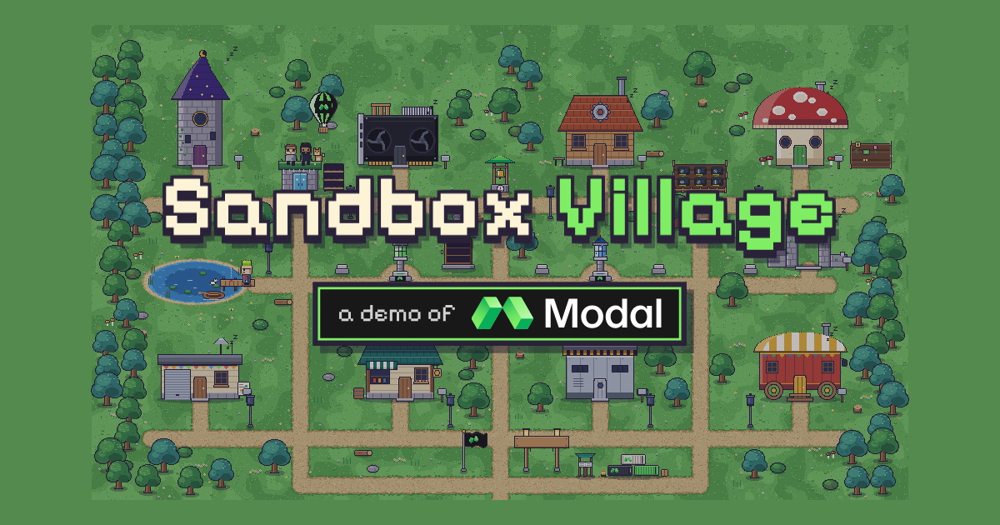

# Sandbox Village

A small 16-bit village you can walk around. Nine odd neighbours live in it: a goat wizard, a
capybara shopkeeper, a robot, the ghost of a cat. Each villager is an LLM character, and each
one's house is a real computer of its own: a [Modal Sandbox](https://modal.com/docs/guide/sandboxes).
They think with two small open models on Modal's Model APIs.

**Play it: https://sandbox-village.modal.dev**



A 30-second trailer is in [`media/demo.mp4`](media/demo.mp4).

The idea comes from the Stanford "generative agents" (Smallville) paper, with one change: here
the agents can do things, because each has a machine to do them on. Ask the shopkeeper for a
teapot and he writes a program in his sandbox that draws one, runs it, and hands you the file.

## What it shows

| In the game | On Modal |
|---|---|
| A house | One Sandbox per villager: a quarter of a CPU, 512 MiB, no way out to the internet. |
| A dark house | No sandbox at all, only a filesystem snapshot of the last one. Nothing is running. |
| Walking up to a dark house | A new sandbox is created from that snapshot. The game says how long it took. |
| A villager thinking (a line to one of the two towers) | One request to a model on Model APIs. Each villager is wired to one of two models. |
| A villager making you something | Shell commands the model wrote, run inside that villager's sandbox. The gift is a file copied out of it. |
| Going into a house | Every object on the shelf is a file in that sandbox. |
| The bell | Every sleeping villager's sandbox started at the same moment. |
| A house you walked away from going dark | The sandbox is snapshotted and terminated after 75 quiet seconds: scale to zero. |
| Ziggy's dare | His sandbox deletes its own system files, for real. Only that house falls, and a new sandbox from the snapshot taken just before brings it back. |
| The library | A Modal Volume mounted in every villager's sandbox, holding a copy of every gift. |
| The village register | The Modal Dict that holds the village's state: who is awake, each sandbox ID, each latest snapshot. |
| The robot's lab | A sandbox on the VM runtime; the others use the default. |
| The ghost's ruin | A sandbox that is never snapshotted. When it stops, everything in it is gone. |
| The maze game on the screen in two houses | Mazes generated by a program in a sandbox, in a sidecar container (a beta feature of Sandboxes) where one can be started. |

"Under the hood" (top right) labels every house with its sandbox or snapshot ID and narrates the
sandbox lifecycle, shell commands and model calls as they happen.

## Things to try

The almanac (top right) keeps this list and ticks each one off, and a yellow arrow points at the
next one:

1. Walk up to a dark house. Whoever lives there wakes up.
2. Ask a villager to make you something.
3. Go into a house and read a file on the shelf.
4. Ring the bell on the top road.
5. Look in the library.
6. Play the maze on the screen in Mo's house.
7. Dare Ziggy, the raccoon, to delete his computer. Then walk up to the rubble.

Move with W A S D or the arrow keys and press E to act; on a phone, tap where you want to go.

## The cast

| Villager | What they are | Their thing | Model | Their own tool | Sandbox |
|---|---|---|---|---|---|
| Orlo the wizard | A goat | Thinks commands are spells and files are scrolls. | GLM 5.3 Flash | `cast_weather` | default |
| Juniper the tinkerer | A beaver | Writes Python that draws SVG objects. | GLM 5.3 Flash | `install` | default |
| Bao the shopkeeper | A capybara | Makes small pictures of things, and hands them over. | GLM 5.3 Flash | none | default |
| Dot the robot | A robot | Counts everything. Knows it lives in a sandbox. | GLM 5.3 Flash | `village_census` | VM runtime |
| Moss the gardener | A frog | Ancient, slow, kind. Talks to the beans. | GLM 5.3 Flash | `plant` | default |
| Fennel the bard | A fennec fox | A travelling bard who never left. | DeepSeek V4.1 Flash | `play_tune` | default |
| Wisp the ghost | The ghost of a cat, probably | Remembers nothing, and is fine with it. | DeepSeek V4.1 Flash | none | never snapshotted |
| Mo the caretaker | Modal's mascot | Keeps the houses running and knows the Sandbox docs. | GLM 5.3 Flash | `ring_bell` | default |
| Ziggy the founder | A raccoon in a hoodie | Runs a startup in his garage that pivots every time you ask. | DeepSeek V4.1 Flash | none | default |

Everyone also has `bash`, `write_file` and `give_item`, and can visit a neighbour. Villagers call
on each other unprompted while somebody is watching.

Three people from Modal appear as figures, with their agreement: Charles fishing off the dock
(he has a two-line card), and Erik and Akshat on the roof of the snapshot cellar. No model speaks
for them.

## How it is put together

```
browser (canvas game, plain JavaScript, no build step)
   |  JSON polling + server-sent events
web          FastAPI: static files, the game API, and one director per village
   |         (scenes, weather, pedestals, the record of events)
   |  remote generator call
think        the villager brain: one stateless agent loop for every villager
   |                         \
   |  exec / files / snapshot   \  OpenAI-compatible HTTPS
sandboxes                        Modal Model APIs
one per awake villager             sandbox-village-brain            GLM 5.3 Flash
                                   sandbox-village-brain-deepseek   DeepSeek V4.1 Flash

night_watchman   every two minutes: snapshots and stops whatever is left running
```

| File | What is in it |
|---|---|
| `app.py` | The Modal app: `web`, `think`, `night_watchman`, and `check`, a smoke test. |
| `village/world.py` | The villagers: personas, models, tools, day-one files. |
| `village/homes.py` | The sandbox state machine (wake, sleep, exec, snapshot, rebuild) and its Modal backend. |
| `village/brain.py` | The agent loop and the tools. Everything that touches files runs in the villager's sandbox. |
| `village/llm.py` | The two models, where their endpoints are, and how requests are signed. |
| `village/town.py` | Village life: the director's scenes, visits, weather, the record of events. |
| `village/villages.py` | One village per visitor, and the limits that keep that bounded. |
| `village/safety.py` | The content filter. |
| `village/server.py`, `village/static/` | The web API and the game. |
| `village/fakes.py` | Folders on your own machine and a scripted brain, for tests and offline work. |

Everything a villager remembers is a file in its sandbox: a diary, notes, and the last few turns
of conversation. The brain keeps nothing between turns, so a villager who deletes its home
really does forget.

Every browser gets a village of its own, named by an ID the browser makes up and sends with each
request. Villagers' states share one Dict with the village's ID in front of every key, each
village's sandboxes mount only its own folder of the library Volume, and two visitors never see
each other's villagers.

## Run it

Python 3.12 or newer, and:

```bash
python -m venv .venv && source .venv/bin/activate && pip install -r requirements.txt
```

### Offline, with no accounts

Homes are folders on your machine and the villagers follow a short script. Good for working on
the game itself.

```bash
python -m village.dev --offline
```

Then open http://127.0.0.1:8787.

### On your machine, with real sandboxes and models

This needs a Modal account (`modal setup`) and the two model endpoints, created once:

```bash
modal endpoint create --shared --model nvidia/GLM-5.3-Flash-NVFP4 --name sandbox-village-brain
```

```bash
modal endpoint create --shared --model deepseek-ai/DeepSeek-V4.1-Flash-1017 --name sandbox-village-brain-deepseek
```

The second is optional: without it, the villagers wired to it think with the first.

```bash
python -m village.dev
```

The server finds the endpoints by name and signs requests with your Modal login (an experimental
feature of the Modal client), or with a proxy token if `MODAL_PROXY_TOKEN_ID` and
`MODAL_PROXY_TOKEN_SECRET` are set. Sandboxes are created in the app `sandbox-village-dev`.

### Deployed on Modal

Two Secrets are expected. The first holds a proxy token for the model endpoints:

```bash
modal workspace proxy-tokens create --name sandbox-village
```

```bash
modal secret create sandbox-village MODAL_PROXY_TOKEN_ID=wk-... MODAL_PROXY_TOKEN_SECRET=ws-...
```

The second holds the content filter's word list, which is kept out of this repository on
purpose (see [Keeping it fit for everyone](#keeping-it-fit-for-everyone)):

```bash
modal secret create sandbox-village-filter VILLAGE_BLOCKLIST="word,another word,a third"
```

Then:

```bash
VILLAGE_KEY=choose-a-password modal deploy app.py
```

Open the `web` URL with `?key=choose-a-password` added. Without `VILLAGE_KEY` anyone with the
URL can play, and every conversation spends tokens.

Either Secret can be done without: `VILLAGE_SECRET=none` lets the brain sign requests with the
function's own Modal identity (experimental), and `VILLAGE_FILTER_SECRET=none` runs with no word
list. If your workspace blocks web URLs that have no Modal-level sign-in, deploy with
`VILLAGE_PROXY_AUTH=1` (requests then need proxy-token headers, which a browser tab does not
send) or use an environment that allows public URLs.

To check a deployment's whole path (web API, brain, a model, a sandbox) without any public URL:

```bash
modal run app.py
```

### Settings

Read from your shell when you deploy, and baked into the app.

| Variable | Meaning | Default |
|---|---|---|
| `VILLAGE_KEY` | Password the game URL needs (`?key=...`) | none |
| `VILLAGE_SECRET` | Secret holding the proxy token, or `none` | `sandbox-village` |
| `VILLAGE_FILTER_SECRET` | Secret holding the filter's word list, or `none` | `sandbox-village-filter` |
| `VILLAGE_PROXY_AUTH` | `1` to require Modal proxy-auth headers on the web URL | off |
| `VILLAGE_DOMAIN` | A custom domain to serve the game on as well | none |
| `VILLAGE_MAX_IN_USE` | How many villages may be in use at once | `50` |
| `VILLAGE_TALKS_PER_HOUR` | Questions to a model per village per hour | `30` |
| `VILLAGE_SHARDS` | How many web containers share the villages (at most 8) | `1` |
| `VILLAGE_WARM` | `1` keeps one `web` and one `think` container running; `all` every web container | off |
| `VILLAGE_BRAIN` | `inline` runs villagers' turns in the web containers, which makes replies start sooner | off |
| `VILLAGE_SHARED` | `1` gives everybody the same village instead of one each | off |
| `VILLAGE_IDLE_S` | Quiet seconds before a villager is put to bed | `75` |
| `VILLAGE_RUNTIME` | `vm` or `gvisor` for the sandboxes (Dot is always on a VM) | Modal chooses |
| `VILLAGE_LLM_ENDPOINT` | Name of the default model's endpoint | `sandbox-village-brain` |
| `VILLAGE_LLM_EFFORT` | Reasoning effort per reply | `low` |
| `VILLAGE_APP` | Name of the Modal app, its Dict and its Volume | `sandbox-village` |

A village's director lives in one container's memory, so each web function is held to a single
container. One container kept up with 50 simulated visitors and lagged at 80; `VILLAGE_SHARDS=4`
with `VILLAGE_MAX_IN_USE=100` held 100.

## What it costs to run

There are no prices in the game, and none here: see [Modal's pricing](https://modal.com/pricing).
What you pay for is:

- **Sandboxes**, while a villager is awake: a quarter of a CPU and 512 MiB each (one core and
  1 GiB at the very most), at most nine per village, each stopped 75 seconds after anyone was
  last near it.
- **Model tokens**, one request per thought.
- **The web containers** (1 CPU, 1 GiB, non-preemptible) and the `think` containers, which stop
  when nobody is playing unless `VILLAGE_WARM` is set.
- **The night watchman**, a few seconds every two minutes.

What keeps a public deployment bounded: the cap on villages in use at once, the questions per
village per hour, villagers acting on their own only while somebody is watching and at most 20
times an hour, a village nobody has looked at for ten minutes being put away, and one nobody has
come back to in a week being deleted.

## Keeping it fit for everyone

`village/safety.py` has two layers, and neither is a guarantee:

1. Every villager's instructions tell them to turn down anything sexual, hateful, cruel or gory.
2. A word list is checked on what a visitor types and the name they give (an unfit message never
   reaches a model), and on what a villager says and hands over: their words in the talk box and
   in speech bubbles, gifts, pedestal pieces, tune titles, crops, and files written with
   `write_file`.

What a villager does with shell commands is not checked: a file made that way, and the output of
a command, can hold whatever the model was talked into, and anyone in that village can read it
off the shelf.

The word list is not in this repository. It is read from the environment variable
`VILLAGE_BLOCKLIST` (entries separated by commas or new lines), which a deployment gets from the
Modal Secret above, or from the file named by `VILLAGE_BLOCKLIST_FILE`. With neither, only the
first layer is at work, and the server says so when it starts. Whole words are matched, with
plain endings and common letter swaps seen through.

A word list cannot judge a drawing, and a small model can be talked round. A village open to
the public should add a moderation model.

## Other safety notes

- Commands a model writes run only inside that villager's sandbox. Sandboxes are created with
  `outbound_cidr_allowlist=[]`, so nothing inside can reach the internet, and no port is opened
  to the outside.
- The model endpoints' credentials are never in a sandbox's environment.
- Paths from a model or the browser are confined to the villager's home directory by name (a
  link made inside a sandbox can still point elsewhere in that same sandbox).
- A sandbox is held to one CPU core and 1 GiB, and a command's output is cut off at 1 MB inside
  the sandbox, so a command a model wrote cannot swamp the server that asked for it.
- File contents and model text are put into the page as text. An SVG a villager drew is shown
  as an image, which does not run scripts. The glossary's pages are the one exception: they are
  shown with their links and pictures, which load from the sites the glossary names.
- The dare's `rm -rf` exists only in the class that talks to real sandboxes and is sent only
  through a sandbox's own `exec`. It names system directories and the home, not `/`, so the
  library Volume is not touched. The game shows a shortened form of the command.
- Offline mode runs commands on your own machine with no isolation. It is wired only to the
  scripted brain, whose commands are fixed. Do not connect a model to it, and keep it on
  `127.0.0.1`.
- Every API route is open to anyone who can reach the URL. A village's ID is a long random
  string known only to its browser; `VILLAGE_KEY` puts a password in front of everything.

## Tests

```bash
python -m pytest tests -q
```

That covers the server side against folders on your machine. For a walk through the game in a
real browser, at desk and phone size:

```bash
npm install && npx playwright install chromium
```

```bash
npm run smoke
```

## Known gaps

- There is no moderation model and no per-person limit. One person can open many villages, each
  with its own hourly allowance, and enough of them fill the cap on villages in use, which turns
  newcomers away until those go quiet (two minutes). A public deployment that matters should put
  a limit per visitor in front of this.
- The night watchman looks at every village seen in the last week, one after another, so its
  work grows with them.
- Waking a house and rebuilding one have no limit of their own, so the bell's fifteen-second
  rest can be got round by waking the nine houses one by one. A village never has more than nine
  sandboxes, whatever is asked.
- Villages are per browser. There is no way to open yours on another device or to invite
  somebody into it.
- A restart or a redeploy forgets recent events (not the villagers' homes, the weather or the
  pedestals), and changing `VILLAGE_SHARDS` moves villages between containers.
- Only filesystem snapshots are used, so processes do not survive sleep.
- A web container that is not kept warm makes its first visitor wait for it to start.

## Credits

- The idea: [Generative Agents: Interactive Simulacra of Human Behavior](https://arxiv.org/abs/2304.03442)
  (Park et al., 2023).
- The book on Mo's table is Modal's [GPU Glossary](https://modal.com/gpu-glossary), copied
  unchanged under CC BY 4.0; see `village/gpu_glossary/NOTICE.md`.
- The pixel fonts, Pixelify Sans and VT323, are bundled under the SIL Open Font License; see
  `village/static/fonts/`.
- The Modal logo files in `village/static/brand/` are Modal's.
- The art and the sound are drawn and generated by code in this repository.

The code is under the MIT licence; see [`LICENSE`](LICENSE). The glossary, the fonts and Modal's
logos keep their own terms, as above.
